<!-- _class: lead -->

# さよなら同期待ち

## Entra Kerberos で変わるハイブリッド参加

HCCJP 第79回勉強会　2026年11月13日

胡田 昌彦

---

# Kerberos方式は、デバイス同期を待たずに登録する

**ADに参加済みのPCを、デバイス情報の事前同期なしでEntraに登録します**

- オンプレADが発行する **Kerberosチケット**を使い、PCを認証して登録する
- このKerberosによるハイブリッド参加機能は、現在 **プレビュー**
- デモでは **デバイス同期未構成の同じPC** で、Kerberosの構成前後の登録結果を比べる

---

# 今日の流れ

1. ADとEntraにPCを登録する、ハイブリッド参加の仕組み
2. 同期方式とKerberos方式では、PCの本人確認がどう違うか
3. Kerberos方式に必要なOSと、AD・Entraの設定
4. **デモ**：デバイス同期を使わずにハイブリッド参加する
5. 導入時の注意点と、今回のデモで検証した範囲

---

<!-- _class: lead -->

# 1. 同期方式によるハイブリッド参加の仕組み

---

# ハイブリッド参加は、AD参加済みPCのEntra登録

**AD にドメイン参加している Windows を、Entra ID にもデバイスとして登録すること**

- PCはADへのドメイン参加を維持し、グループポリシーも引き続き使う
- EntraにもデバイスIDを持ち、クラウド側でPCを識別できるようになる
- 条件付きアクセスで、ハイブリッド参加済みという状態を利用できる
- ユーザーのSSOやIntune管理の土台になるが、それぞれ別の設定・検証が必要

---

<!-- _class: small -->

# 同期方式の登録処理は、PC・AD・Entraで分担する

| 場所 | 名前 | 役割 |
|---|---|---|
| クライアント | **タスク スケジューラ** | 決まったきっかけで登録処理を起動する |
| クライアント | **dsregcmd.exe** | PCのEntra登録を実行する |
| クライアント | **TPM / 証明書ストア** | 鍵を守る / デバイス証明書を保存する |
| オンプレ | **SCP** | PCが登録先のEntraテナントを調べるためのAD内の情報 |
| オンプレ | **Entra Connect Sync** | AD を Entra へ同期する。**デバイスも同期する** |
| クラウド | **DRS** | Device Registration Service。デバイス登録を受け付ける |
| クラウド | **Entra ID** | 登録されたPCのデバイス情報を保持する |

---

<!-- _class: small -->

# PCの自動登録は、SYSTEMで動くタスクが開始する

`\Microsoft\Windows\Workplace Join\` に3つのタスクがある（デモ環境の Windows 11 で確認）

| タスク | 実行ユーザー | 動作 |
|---|---|---|
| **Automatic-Device-Join** | SYSTEM | `dsregcmd.exe`を実行し、**PCをEntraへ登録する** |
| Device-Sync | SYSTEM | 登録後の同期 |
| Recovery-Check | ログオンユーザー | 回復の確認（既定は無効） |

**Automatic-Device-Join** が動くきっかけ

- ユーザーのサインインの **1分後**
- 登録イベント（`User Device Registration/Admin` の **4096**）が出たとき、以後 **1時間ごと**
- 1回の実行は最長 **5分**

---

<!-- _class: small -->

# 同期方式では、初期認証と登録完了後で証明書が異なる

| | 初期認証に使う証明書 | 登録完了後に使う証明書 |
|---|---|---|
| もの | **自己署名証明書** | **デバイス証明書** |
| 発行者 | PC自身 | **DRS**（`MS-Organization-Access`） |
| 秘密鍵 | TPM | TPM（別の鍵） |
| 置き場所 | **AD の `userCertificate` だけ** | 証明書ストア `LocalMachine\My` |
| 役目 | ADから同期された情報と照合し、PCを認証する | 登録後のPCの認証に使う |

**自己署名証明書を作るだけでは不十分。ADから届いた情報との照合が必要です**

鍵と保存先は今回のWindows 11ラボでの観測。表は用途の区別で、古い証明書の削除を示すものではありません

---


# 同期方式は、デバイス情報の同期後に登録を完了する

次の図では、マネージド環境の同期ベースのハイブリッド参加を順に説明します

- 青い矢印: いま起きている処理
- 灰色の矢印: すでに終わった処理
- 赤: 失敗

---

<!-- _header: "" -->
<!-- _footer: "" -->
<!-- _paginate: false -->

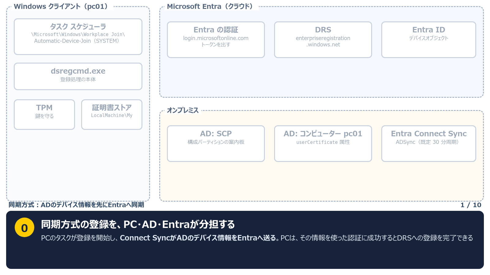

---

<!-- _header: "" -->
<!-- _footer: "" -->
<!-- _paginate: false -->

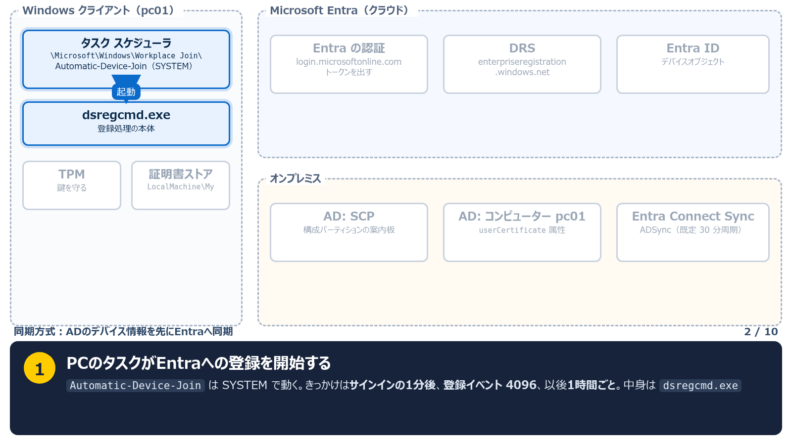

---

<!-- _header: "" -->
<!-- _footer: "" -->
<!-- _paginate: false -->

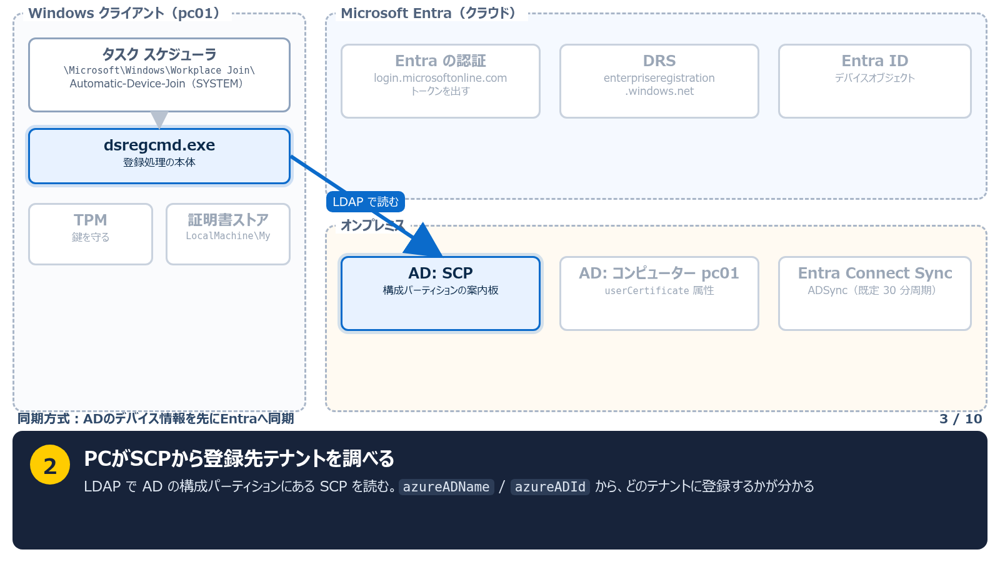

---

<!-- _header: "" -->
<!-- _footer: "" -->
<!-- _paginate: false -->

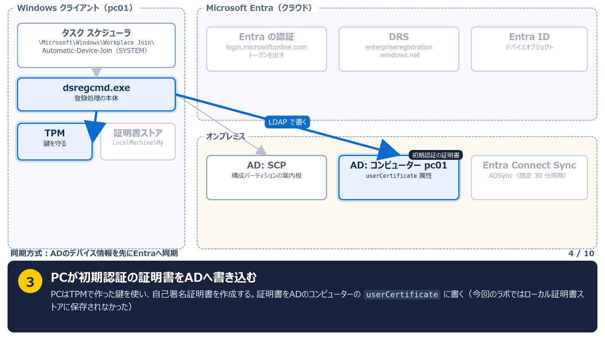

---

<!-- _header: "" -->
<!-- _footer: "" -->
<!-- _paginate: false -->

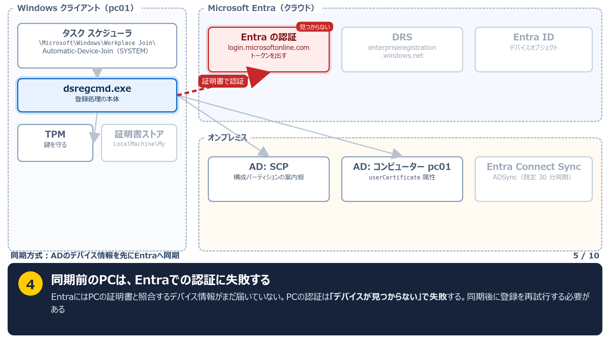

---

<!-- _header: "" -->
<!-- _footer: "" -->
<!-- _paginate: false -->

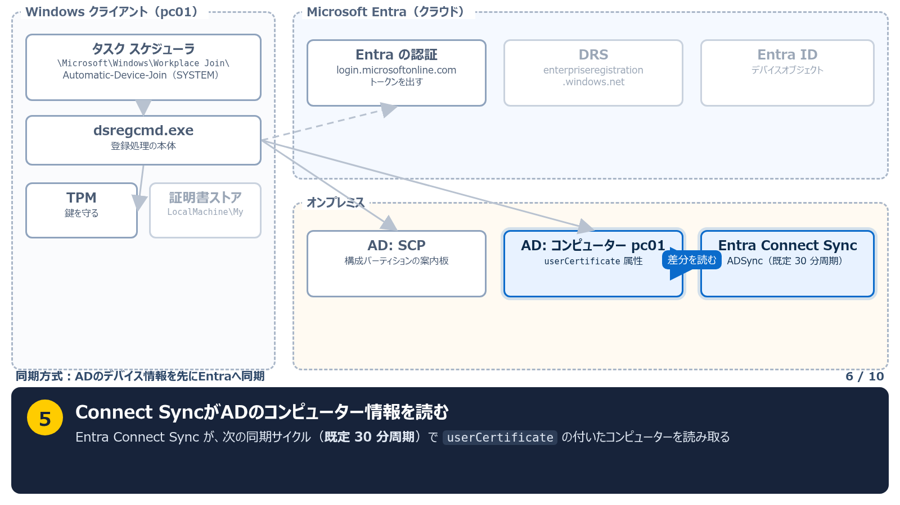

---

<!-- _header: "" -->
<!-- _footer: "" -->
<!-- _paginate: false -->

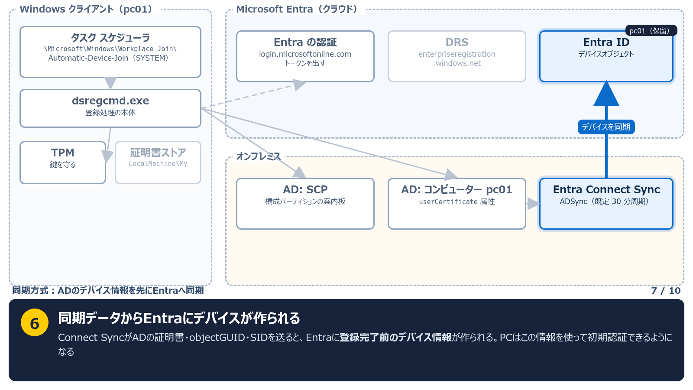

---

<!-- _header: "" -->
<!-- _footer: "" -->
<!-- _paginate: false -->

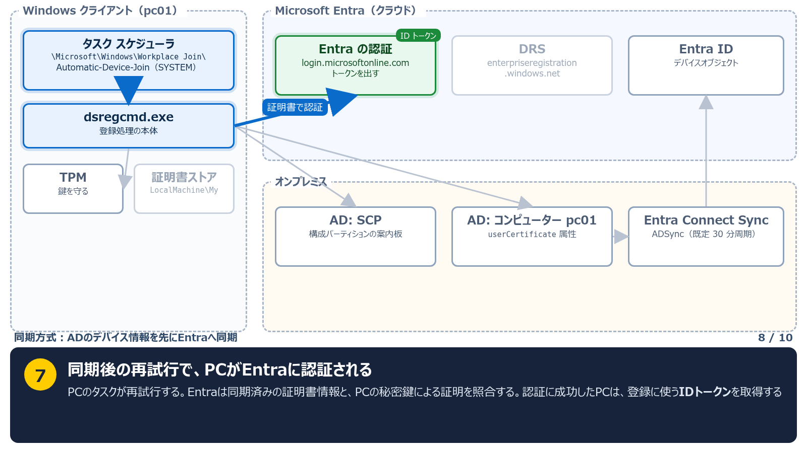

---

<!-- _header: "" -->
<!-- _footer: "" -->
<!-- _paginate: false -->

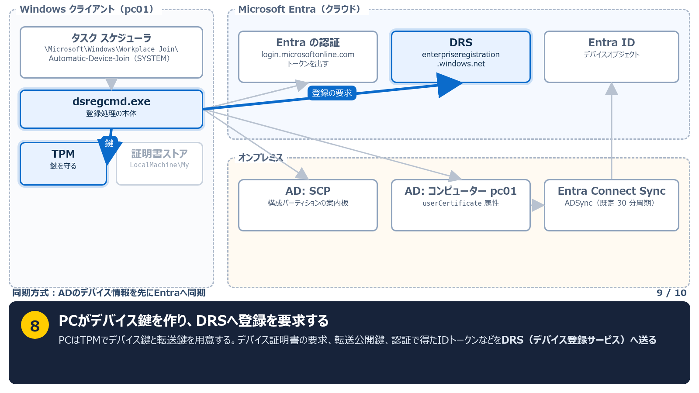

---

<!-- _header: "" -->
<!-- _footer: "" -->
<!-- _paginate: false -->

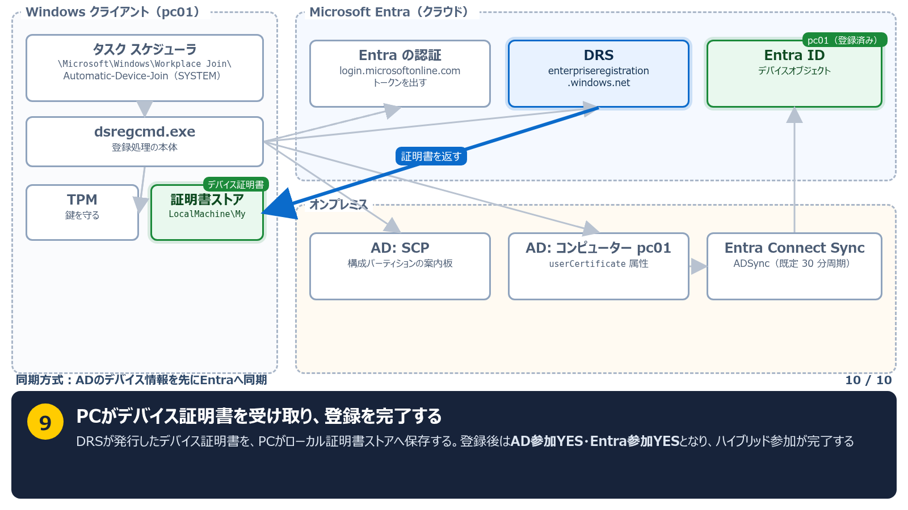

---

<!-- _class: small -->

# デバイスの同期待ちは、ハイブリッド参加の完了を遅らせる

- **Autopilotのハイブリッド参加**：デバイス同期を待つ時間が発生する
- **条件付きアクセス**：参加完了前は「ハイブリッド参加済み」の条件を満たせない
- **非永続VDI**：同期完了前にVMが破棄されると、登録も完了できない
- **デバイス同期を構成していない環境**: 同期ベースの登録は完了しない

PCは **デバイス情報がEntraへ届くことと、その後の登録再試行** を待ちます

---

<!-- _class: small -->

# デバイス同期を使う登録と、Kerberosを使う登録は別の経路

**現在のCloud Syncにも、デバイス同期の公式手順があります**

| 経路 | 登録の前に必要なこと |
|---|---|
| 同期ベース | デバイス情報が同期でEntraに届くこと |
| Kerberos方式 | AD発行の紹介チケットを起点に本人確認すること |

**Kerberos方式では、登録前にデバイス情報を同期しておく必要がありません**

今回のラボではユーザー同期を有効にし、デバイス同期は構成していません

出典: [Cloud Sync Device Sync](https://learn.microsoft.com/en-us/entra/identity/hybrid/cloud-sync/device-sync)

---

<!-- _class: lead -->

# 2. Kerberos方式がデバイス同期を待たない仕組み

---

# Kerberos方式は、ADのチケットでPCを認証する

**EntraはAD発行のチケットを信頼し、デバイス情報の事前同期なしで登録を受け付けます**

Microsoftが、このプレビュー機能の利用例として挙げている環境

- 非永続 VDI のハイブリッド参加
- ユーザー同期にCloud Syncを使う環境
- Azure Virtual Desktop / Windows 365 のプロビジョニング改善
- Entra Connect Sync を使えない分断フォレスト

---

<!-- _header: "" -->
<!-- _footer: "" -->
<!-- _paginate: false -->

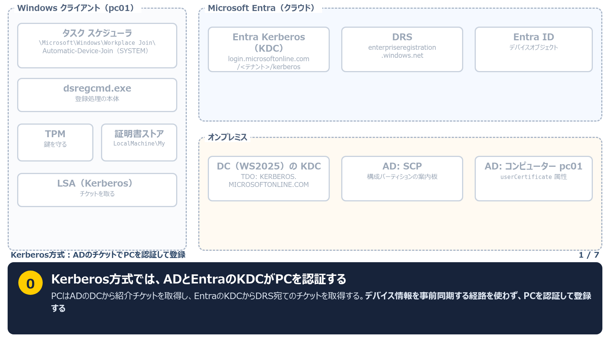

---

<!-- _header: "" -->
<!-- _footer: "" -->
<!-- _paginate: false -->

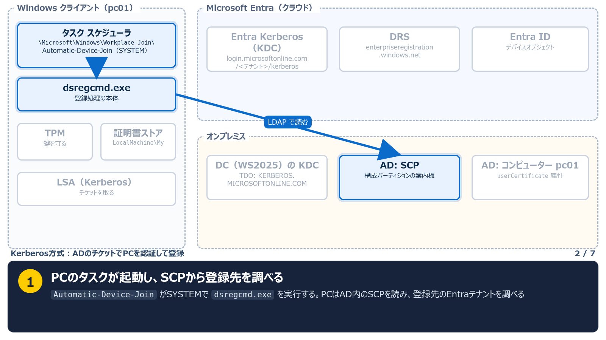

---

<!-- _header: "" -->
<!-- _footer: "" -->
<!-- _paginate: false -->

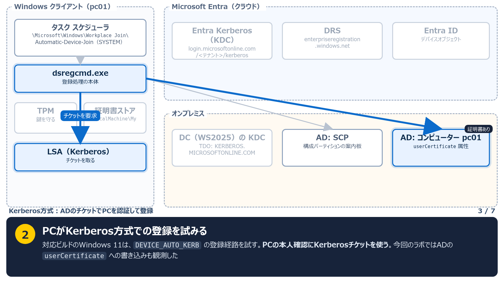

---

<!-- _header: "" -->
<!-- _footer: "" -->
<!-- _paginate: false -->

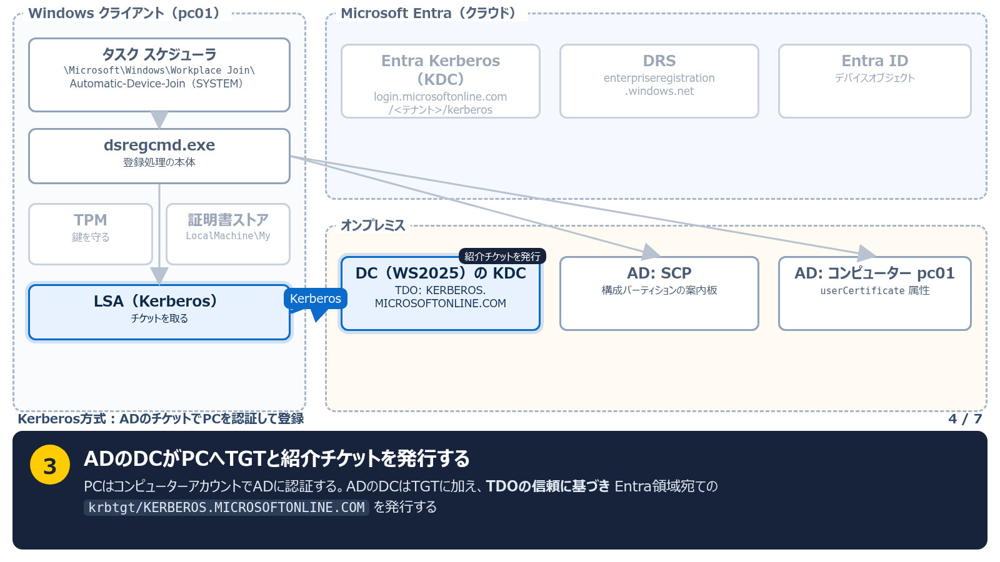

---

<!-- _header: "" -->
<!-- _footer: "" -->
<!-- _paginate: false -->

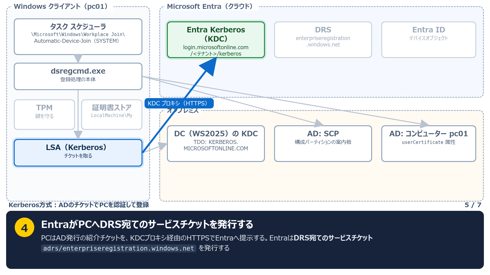

---

<!-- _header: "" -->
<!-- _footer: "" -->
<!-- _paginate: false -->

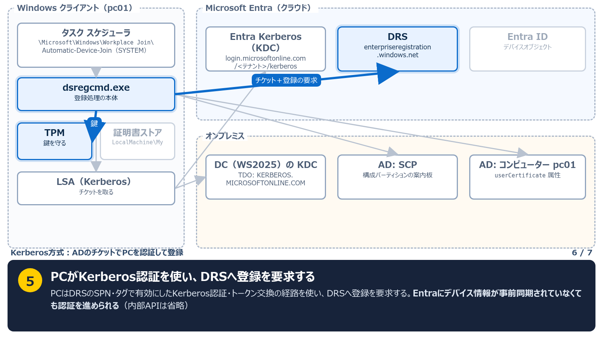

---

<!-- _header: "" -->
<!-- _footer: "" -->
<!-- _paginate: false -->

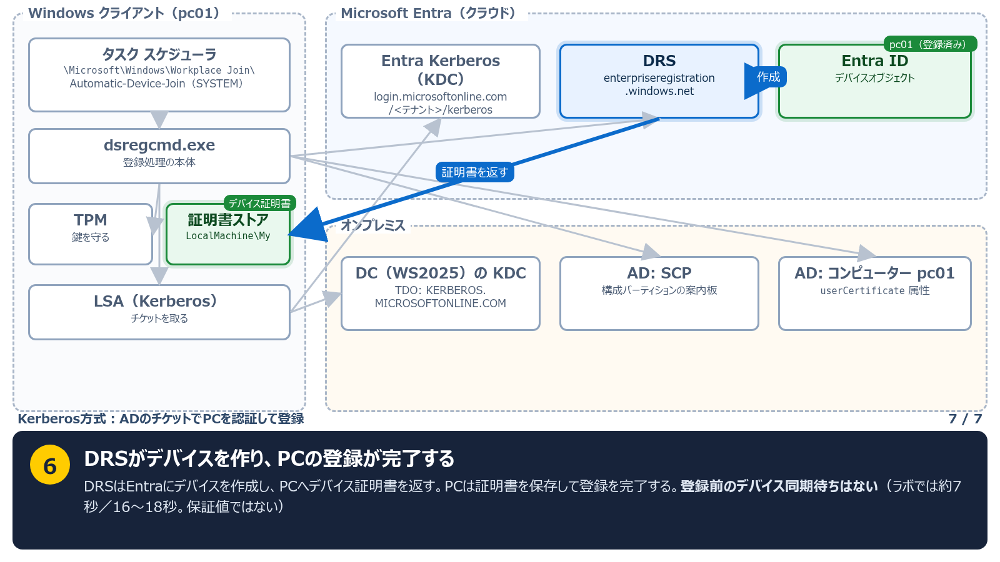

---

# TDOは、EntraがADを信頼するための記録

TDO（Trusted Domain Object）は、ADに置く **別のKerberos領域との信頼関係の記録** です

- 別のドメインと信頼関係を結ぶと、AD に同じ種類のオブジェクトができる
- 今回の相手は別の AD ではなく、**Entra の Kerberos 領域** `KERBEROS.MICROSOFTONLINE.COM`
- 今回の構成では **Entraが、このADの発行した紹介チケットを受け入れる**
- ADのDCはPCへ **EntraのKerberos領域宛ての紹介チケット** を発行できる

---

# AD側のInboundは、EntraがADを信頼するという意味

| | |
|---|---|
| 信頼する側 | **Entra**（AD発行の紹介チケットを受け入れる） |
| 信頼される側 | **AD** |
| アクセスの向き | **AD の PC → Entra のサービス** |
| AD から見た方向 | `Inbound`（受信） |

**InboundはAD側から見た信頼の表記です。PCがアクセスする方向とは区別します**

---

<!-- _class: small -->

# PCの登録と、ユーザーのオンプレ認証では使う構成が異なる

`Set-AzureADKerberosServer` は、役割の違うものを AD に作ります

| | ユーザーがオンプレ資源を使う経路 | PCをEntraへ登録する経路 |
|---|---|---|
| 作られるもの | `krbtgt_AzureAD`、`AzureADKerberos` | **TDO**（`-SetupCloudTrust` を付けたとき） |
| アクセスの向き | クラウドの身分証 → オンプレの資源 | **オンプレの PC → クラウドのサービス** |
| 代表例 | WHfB Cloud Kerberos Trust、FIDO2 | SQL MI の受信フロー、**デバイス登録** |

WHfB Cloud Kerberos Trustが構成済みでも、**今回のTDOがあるとは限りません**

---

<!-- _class: lead -->

# 3. Kerberos方式の前提条件と構成手順

---

<!-- _class: small -->

# Kerberos方式には、対応OSとDCへの通信が必要

| 項目 | 内容 |
|---|---|
| DC | Windows Server 2025 **ビルド 26100.6905 以降**を、**ドメインごとに1台以上** |
| クライアント | Windows 11 **ビルド 26100.6584 以降** |
| ネットワーク | 参加のときに、クライアントから WS2025 の DC へ到達できること |
| AD の権限 | Domain Admins と Enterprise Admins |
| Entra の権限 | ハイブリッド ID 管理者、アプリケーション管理者 |
| ライセンス | このプレビュー機能自体に追加要件なし |

---

<!-- _class: small -->

# Kerberos方式の導入では、同期・信頼・DRS・SCPを構成する

| # | やること |
|---|---|
| 1 | **同期を有効にする**（Connect Sync または Cloud Sync） |
| 2 | **TDO を作る**: `Set-AzureADKerberosServer -SetupCloudTrust` |
| 3 | **DRSのサービスプリンシパルにSPNとタグを設定する** |
| 4 | **SCPを置く** |

このラボでは、対応OS・AD参加・通信の前提を満たしたPCに専用の追加設定はしていません

既存のKDCプロキシGPOがある環境は、公式手順に従い調整します

**同期はTDO作成の前に有効化**します（ラボで未有効時の失敗を確認）

---

<!-- _class: small -->

# Kerberos方式でも、AD参加とユーザー同期は必要

| | |
|---|---|
| 登録のために不要になるもの | デバイス情報の事前同期、AD FSによる初期認証 |
| 引き続き必要なもの | ADドメイン参加、SCP、**ユーザー同期** |
| Kerberos方式に必要なDC | 対応ビルドのWindows Server 2025 |
| ラボで観測した動作 | Kerberos方式でもADの`userCertificate`へ書き込まれた |

**Autopilot のハイブリッド参加がクラウドネイティブになるわけではありません。** 速くなるのは登録の部分で、ドメイン参加は従来どおりです

---

<!-- _class: lead -->

# 4. デモ：Kerberosの構成前後で登録結果を比較

デバイス同期未構成の同じPCで、構成前の登録失敗と構成後の登録成功を確認します

---

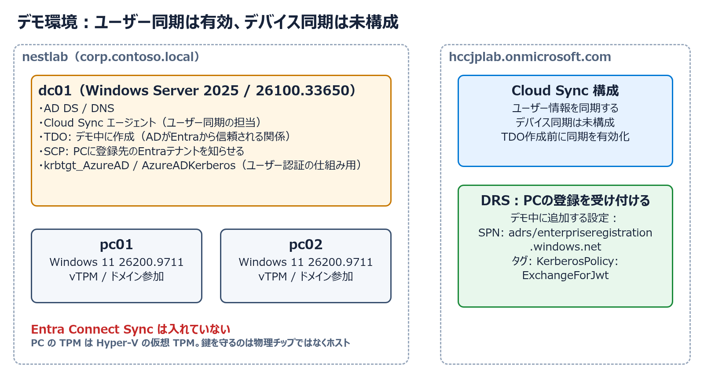

<!--
環境は hyperv-nestlab（OSS）で自動構築した。紹介動画 https://youtu.be/nKnSazofKxs
-->

---

<!-- _class: small -->

# デモ：Kerberosの構成前後で登録結果を比較する

| # | やること | 見るところ |
|---|---|---|
| 1 | `pc01`の参加状態を確認 | AD参加済み、Entra未参加 |
| 2 | Kerberos未構成で登録を試行 | Kerberos経路も、同期ベースの経路も失敗 |
| 3 | TDOとDRSを構成 | 信頼関係と、DRSのSPN・タグを確認 |
| 4 | 同じPCで登録を再試行 | AD参加・Entra参加の両方がYESになる |
| 5 | PCのKerberosチケットを確認 | AD発行の紹介チケットと、Entra発行のDRS宛てチケット |

ポイント: **Connect Sync は未導入。Cloud Sync のデバイス同期も使いません**

---

<!-- _class: demo small -->

# デモ1：pc01はAD参加済みで、Entraには未登録

`pc01` で実行

```powershell
dsregcmd /status | Select-String "AzureAdJoined", "DomainJoined"
```

期待する結果

```text
AzureAdJoined : NO
DomainJoined : YES
```

Entra 管理センターのデバイス一覧にも、`pc01` はまだありません

---

<!-- _class: demo small -->

# デモ2：Kerberos未構成のpc01で、Entraへの登録を試す

`pc01` の管理者PowerShellで、実行開始時刻を記録してタスクを起動する

```powershell
$since = Get-Date
schtasks /run /tn "\Microsoft\Windows\Workplace Join\Automatic-Device-Join"
```

タスク完了後に、**今回の実行時刻以降**のログを確認する

```powershell
Get-WinEvent -FilterHashtable @{
    LogName = "Microsoft-Windows-User Device Registration/Admin"
    StartTime = $since
} | Sort-Object TimeCreated | Select-Object TimeCreated, Id, Message
```

---

<!-- _class: demo small -->

# デモ2：Kerberos未構成とデバイス同期なしのため、登録に失敗

今回のラボでは **Kerberos経路を試した後、同期方式の経路でも失敗** しました

| 順 | 方式 | 結果 |
|---|---|---|
| 1 | Kerberos方式 `DEVICE_AUTO_KERB` | Kerberos チケットが取れない（イベント 420） |
| 2 | 同期方式 `DEVICE_AUTO` | `The device object ... is not found.`（イベント 304） |

このラボはデバイス同期未構成のため、**待つだけでは従来経路は進みません**

TDOが残りDRSが未設定の場合、Kerberos経路も304になることがあります。ログの時刻と本文を読みます

---

<!-- _class: demo small -->

# デモ3：ADとEntraの信頼関係をTDOで構成する

`dc01` の管理者PowerShellで実行。Entraには `labadmin` で対話サインインする

```powershell
$domainCred = Get-Credential CORP\Administrator
Set-AzureADKerberosServer -Domain corp.contoso.local `
    -UserPrincipalName labadmin@hccjplab.onmicrosoft.com `
    -DomainCredential $domainCred -SetupCloudTrust

Get-ADTrust -Filter * | Select-Object Name, Direction
```

期待する結果

```text
Name                         Direction
----                         ---------
KERBEROS.MICROSOFTONLINE.COM   Inbound
```

---

<!-- _class: demo small -->

# デモ3：DRSに追加するSPNとタグを準備する

`dc01` の管理者PowerShell。対象テナントへサインインし、既存値を保持します

```powershell
Connect-Entra -TenantId hccjplab.onmicrosoft.com `
    -Scopes "Application.ReadWrite.All"
$appId = "01cb2876-7ebd-4aa4-9cc9-d28bd4d359a9"
$drs = Get-EntraServicePrincipal -Filter "AppId eq '$appId'"
if (-not $drs) { throw "DRS service principal not found" }
$spns = @($drs.ServicePrincipalNames | Where-Object { $null -ne $_ })
$tags = @($drs.Tags | Where-Object { $null -ne $_ })
$kerbSpn = "adrs/enterpriseregistration.windows.net"
$kerbTag = "KerberosPolicy:ExchangeForJwt"
```

`01cb2876-...` はDRSのアプリID。次のページも **同じPowerShell** で続けます

---

<!-- _class: demo small -->

# デモ3：DRSのSPN・タグを設定し、反映を確認する

既存のSPN・タグを残し、**同じ値を二重追加しません**

```powershell
if ($spns -notcontains $kerbSpn) { $spns += $kerbSpn }
if ($tags -notcontains $kerbTag) { $tags += $kerbTag }
Set-EntraServicePrincipal -ObjectId $drs.Id `
    -ServicePrincipalNames $spns -Tags $tags
$drs = Get-EntraServicePrincipal -ObjectId $drs.Id
$drs.ServicePrincipalNames -contains $kerbSpn
$drs.Tags -contains $kerbTag
```

最後の2行が **両方 `True`** なら、SPNとタグが登録されています

---

<!-- _class: demo small -->

# デモ4：Kerberos構成後にpc01の登録を再試行する

`pc01` の管理者PowerShellで、デモ2と同じタスクを起動する

```powershell
schtasks /run /tn "\Microsoft\Windows\Workplace Join\Automatic-Device-Join"
```

**schtasksの成功表示は、タスク起動の受付です。** 登録処理の完了後に、次の状態を確認します

```powershell
$fields = "AzureAdJoined", "DomainJoined", "TpmProtected",
          "DeviceAuthStatus", "DeviceId"
dsregcmd /status | Select-String $fields
```

---

<!-- _class: demo small -->

# デモ4：AD参加とEntra参加の両方がYESなら登録完了

pc01の `dsregcmd /status` で、次の状態を確認します

期待する結果

```text
AzureAdJoined : YES
DomainJoined : YES
TpmProtected : YES
DeviceAuthStatus : SUCCESS
```

Entra側と `DeviceId` を照合します。参加成功はユーザーSSOの確認とは別です

<!-- DeviceAuthStatusはデバイスの存在・有効性。約7秒／16〜18秒はラボ値で性能保証ではない。 -->

---

<!-- _class: demo small -->

# デモ5：PCが取得した3種類のKerberosチケットを確認する

`pc01` の管理者PowerShellで、SYSTEM（`0x3e7`）のチケットを見る

```powershell
klist -li 0x3e7
```

期待する結果（抜粋）

| # | チケットの宛先 | 発行元 |
|---|---|---|
| 1 | `krbtgt/CORP.CONTOSO.LOCAL` | `dc01`（AD の身分証） |
| 2 | `krbtgt/KERBEROS.MICROSOFTONLINE.COM` | `dc01`（**Entra への紹介状**） |
| 3 | `adrs/enterpriseregistration.windows.net` | **`KdcProxy:login.microsoftonline.com`** |

**DRS宛てのサービスチケットはEntraが発行**します。PCがKerberos経路を使ったことを確認できます

---

<!-- _class: lead -->

# 5. Kerberos方式で変わる点と導入時の注意

---

# Kerberos方式は、登録前のデバイス同期待ちをなくす

- 従来の同期ベースの登録は、**デバイス情報が Entra に届くのを待っていた**
- Kerberos方式では、**AD発行のチケットでPCを認証して登録する**
- **対応OS・DCへの通信**に加え、**同期・TDO・DRS・SCP**の構成が必要
- **Connect Syncやデバイス同期待ちを使わずに**ハイブリッド参加できる

---

<!-- _class: small -->

# Kerberos方式の前提条件と、今回の未検証項目

- **プレビュー**です。本番環境で使う前に、最新のドキュメントを確認してください
- 登録前のデバイス同期は不要になりますが、**ユーザー同期**は引き続き必要です
- 参加するとき、クライアントから **WS2025 の DC に到達できる**必要があります
- ドメインに WS2025 の DC が複数あるなら、**すべて対象ビルド以降**にします
- 今回検証したのは **デバイス登録とチケット取得まで**。ユーザーのサインイン・PRTは未検証です

---

<!-- _class: small -->

# 仕様・前提条件・構成手順の確認先

- [Microsoft Entra hybrid join using Microsoft Entra Kerberos (preview)](https://learn.microsoft.com/en-us/entra/identity/devices/how-to-hybrid-join-using-microsoft-entra-kerberos)
- [Cloud Syncのデバイス同期](https://learn.microsoft.com/en-us/entra/identity/hybrid/cloud-sync/device-sync)
- [How Microsoft Entra device registration works](https://learn.microsoft.com/en-us/entra/identity/devices/device-registration-how-it-works)
- [Windows Authentication for Microsoft Entra ID with the incoming trust-based flow](https://learn.microsoft.com/en-us/azure/azure-sql/managed-instance/winauth-azuread-setup-incoming-trust-based-flow)
- デモ環境の自動構築: [hyperv-nestlab](https://github.com/ebibibi/hyperv-nestlab)

---

<!-- _class: lead -->

# 質疑応答：ハイブリッド参加とKerberos方式について

ご質問はコメント欄・FlowAsk からどうぞ
