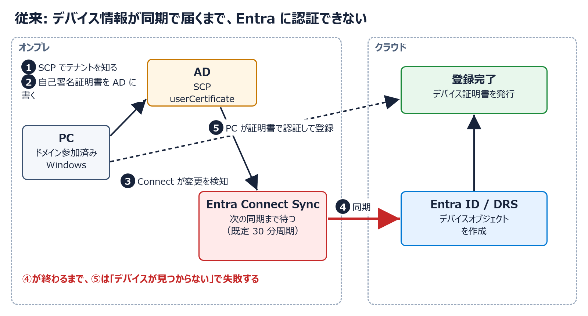
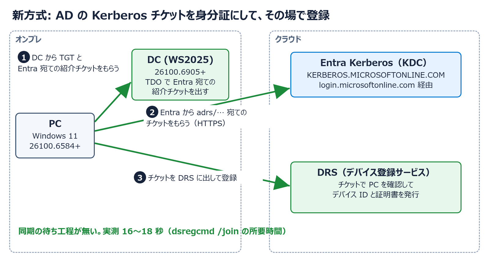

<!-- _class: lead -->

# さよなら同期待ち

## Entra Kerberos で変わるハイブリッド参加

HCCJP 第79回勉強会　2026年11月13日

胡田 昌彦

---

# 今日のお話を一言で

**ハイブリッド参加が、同期を待たずに終わるようになります**

- オンプレの AD が発行する **Kerberos チケット**を身分証にして、Entra にその場で登録する
- 現在は**プレビュー**
- 今日は仕組みを説明したあと、**同じ PC で「失敗 → 構成 → 成功」をやって見せます**

---

# 今日の流れ

1. 従来のハイブリッド参加は、何を待っていたのか
2. プレビューで何が変わるのか
3. 必要なもの、構成するもの
4. **デモ**: 失敗する PC を、その場で参加させる
5. まとめと注意点

---

<!-- _class: lead -->

# 1. 従来のハイブリッド参加

---

<!-- _class: small -->

# 登場人物

| 名前 | 役割 |
|---|---|
| **AD** | オンプレのディレクトリ。PC はここにドメイン参加している |
| **Entra ID** | クラウドのディレクトリ。ここにデバイスを登録したい |
| **DRS** | Device Registration Service。Entra 側でデバイス登録を受け付ける |
| **SCP** | AD に置く案内板。「この AD の PC はこのテナントに登録する」と書いてある |
| **Entra Connect Sync** | AD を Entra へ同期する従来のサーバー。**デバイスも同期する** |
| **Cloud Sync** | 新しい同期の仕組み。**ユーザーとグループを同期し、デバイスは同期しない** |

---

# なぜ「待ち」が生まれるのか

PC はまだ Entra に存在しないので、**自分で名乗っても認証してもらえない**

そのため、従来は次の遠回りをしていました

1. PC が自分の証明書を作って AD に書く
2. 同期サーバーがそれを Entra へ運ぶ
3. Entra に自分の情報が届いてから、やっと認証して登録できる

---



---

<!-- _class: small -->

# Microsoft の手順で見る従来の流れ

| 手順 | 何が起きるか |
|---|---|
| A | ドメイン参加やサインインをきっかけにタスクが動く（1時間ごとに再試行） |
| B | AD の **SCP** を読んで、登録先のテナントを知る |
| C | **自己署名証明書**を作り、AD のコンピューターの `userCertificate` に書く |
| D | Entra Connect が変更を検知し、**次の同期サイクル**で Entra にデバイスを作る |
| E | タスクが証明書で認証して、ID トークンをもらう |
| F〜H | TPM に鍵を作って DRS に登録し、デバイス証明書を受け取る |

**D が終わるまで、E は成功しません**

---

# 同期待ちが生んでいた問題

- **Autopilot**: 同期が終わるまで、ユーザーを待たせる
- **条件付きアクセス**: ハイブリッド参加を求めるポリシーに弾かれる
- **非永続 VDI**: 同期が終わる前にマシンが消える
- **Cloud Sync だけの環境**: デバイスを同期しないので、**そもそも完了しない**

その結果、デバイス同期のためだけに Connect Sync を残している環境があります

---

<!-- _class: lead -->

# 2. プレビューで何が変わるのか

---

# Entra Kerberos によるハイブリッド参加

**同期を待たずに、ハイブリッド参加を完了できる**

Microsoft が挙げている用途

- 非永続 VDI のハイブリッド参加
- Cloud Sync を使う（使いたい）環境
- Azure Virtual Desktop / Windows 365 のプロビジョニング改善
- Entra Connect Sync を使えない分断フォレスト

---



---

# TDO（Trusted Domain Object）とは

AD の中にある**信頼関係の記録**です

- 別のドメインと信頼関係を結ぶと、AD に同じ種類のオブジェクトができる
- 今回の相手は別の AD ではなく、**Entra の Kerberos 領域** `KERBEROS.MICROSOFTONLINE.COM`
- 内容は「**Entra は、この AD が発行した身分証を受け入れる**」
- これがあるので、DC は PC に **Entra への紹介状**を発行できる

---

# 信頼の向きに注意

| | |
|---|---|
| 信頼する側 | **Entra**（AD の身分証を受け入れる） |
| 信頼される側 | **AD** |
| アクセスの向き | **AD の PC → Entra のサービス** |
| AD から見た方向 | `Inbound`（受信） |

AD から見ると「相手から信頼されている」ので **Inbound** になります

---

<!-- _class: small -->

# 「Entra Kerberos」は2つの話で使われる

`Set-AzureADKerberosServer` は、役割の違うものを AD に作ります

| | ユーザー認証の仕組み | 今日の仕組み |
|---|---|---|
| 作られるもの | `krbtgt_AzureAD`、`AzureADKerberos` | **TDO**（`-SetupCloudTrust` を付けたとき） |
| アクセスの向き | クラウドの身分証 → オンプレの資源 | **オンプレの PC → クラウドのサービス** |
| 代表例 | WHfB Cloud Kerberos Trust、FIDO2 | SQL MI の受信フロー、**デバイス登録** |

名前が同じでも、向きと用途が違います

---

<!-- _class: lead -->

# 3. 必要なものと構成

---

<!-- _class: small -->

# 前提条件

| 項目 | 内容 |
|---|---|
| DC | Windows Server 2025 **ビルド 26100.6905 以降**を、**ドメインごとに1台以上** |
| クライアント | Windows 11 **ビルド 26100.6584 以降** |
| ネットワーク | 参加のときに、クライアントから WS2025 の DC へ到達できること |
| AD の権限 | Domain Admins と Enterprise Admins |
| Entra の権限 | ハイブリッド ID 管理者、アプリケーション管理者 |
| ライセンス | 不要 |

---

<!-- _class: small -->

# 構成するのは4つ。クライアントは何もしない

| 手順 | やること |
|---|---|
| 1 | **同期を有効にする**（Connect Sync または Cloud Sync） |
| 2 | **TDO を作る**: `Set-AzureADKerberosServer -SetupCloudTrust` |
| 3 | **DRS のサービスプリンシパルを設定**: SPN `adrs/enterpriseregistration.windows.net` とタグ `KerberosPolicy:ExchangeForJwt` |
| 4 | **SCP を置く** |

⚠️ 同期が無効のまま手順2を実行すると、次のエラーで失敗します

`Identity synchronization is not yet activated for this company`

---

<!-- _class: small -->

# 消えるもの・残るもの

| | |
|---|---|
| ❌ 不要になる | デバイスの同期、同期待ち、登録のための AD FS |
| ✅ 残る | ドメイン参加そのもの、SCP、**ユーザーの同期** |
| ✅ 新しく要る | WS2025 の DC |
| 🤔 検証で分かった | `userCertificate` は今も AD に書かれる |

**Autopilot のハイブリッド参加がクラウドネイティブになるわけではありません。** 速くなるのは登録の部分で、ドメイン参加は従来どおりです

---

<!-- _class: lead -->

# 4. デモ

失敗する PC を、その場で参加させる

---


<!--
環境は hyperv-nestlab（OSS）で自動構築した。紹介動画 https://youtu.be/nKnSazofKxs
-->

---

<!-- _class: small -->

# デモでやること

| # | やること | 見るところ |
|---|---|---|
| 1 | `pc01` の状態を確認する | まだハイブリッド参加していない |
| 2 | 構成前に参加させる | **失敗する**。新方式を試したあと、従来方式でも失敗する |
| 3 | TDO を作り、DRS を設定する | AD に TDO ができる |
| 4 | もう一度参加させる | **数十秒で成功する** |
| 5 | チケットを確認する | Entra が発行したチケットがある |

ポイント: **Cloud Sync だけの環境で、Connect Sync は入れていません**

---

<!-- _class: demo small -->

# デモ1: pc01 の状態を確認する

`pc01` で実行

```powershell
dsregcmd /status | Select-String "AzureAdJoined", "DomainJoined"
```

期待する結果

```text
AzureAdJoined : NO
DomainJoined : YES
```

Entra 管理センターのデバイス一覧にも、`pc01` はまだありません

---

<!-- _class: demo small -->

# デモ2: 構成前に参加させる

`pc01` で、ハイブリッド参加のタスクを実行してログを見る

```powershell
schtasks /run /tn "\Microsoft\Windows\Workplace Join\Automatic-Device-Join"
Get-WinEvent -LogName "Microsoft-Windows-User Device Registration/Admin" -MaxEvents 5
```

期待する結果（**2回失敗する**）

| 順 | 方式 | 結果 |
|---|---|---|
| 1 | 新方式 `DEVICE_AUTO_KERB` | Kerberos チケットが取れない（イベント 420） |
| 2 | 従来方式 `DEVICE_AUTO` | `The device object ... is not found.`（イベント 304） |

Cloud Sync はデバイスを同期しないので、**待っても解決しません**

---

<!-- _class: demo small -->

# デモ3: TDO を作る

`dc01` で実行

```powershell
Set-AzureADKerberosServer -Domain corp.contoso.local `
    -UserPrincipalName labadmin@hccjplab.onmicrosoft.com `
    -DomainCredential $domainCred -SetupCloudTrust

Get-ADTrust -Filter * | Select-Object Name, Direction
```

期待する結果

```text
Name                         Direction
----                         ---------
KERBEROS.MICROSOFTONLINE.COM   Inbound
```

---

<!-- _class: demo small -->

# デモ3（続き）: DRS を設定する

Microsoft Entra PowerShell で実行

```powershell
Connect-Entra -Scopes "Application.ReadWrite.All"
$drs = Get-EntraServicePrincipal -Filter "AppId eq '01cb2876-7ebd-4aa4-9cc9-d28bd4d359a9'"
$spns = [Collections.Generic.List[string]]::new($drs.ServicePrincipalNames)
$tags = [Collections.Generic.List[string]]::new($drs.Tags)
$spns.Add("adrs/enterpriseregistration.windows.net")
$tags.Add("KerberosPolicy:ExchangeForJwt")
Set-EntraServicePrincipal -ObjectId $drs.Id -ServicePrincipalNames $spns -Tags $tags
```

`01cb2876-...` は Device Registration Service のアプリ ID です

---

<!-- _class: demo small -->

# デモ4: もう一度参加させる

`pc01` で、デモ2と同じタスクを実行

```powershell
schtasks /run /tn "\Microsoft\Windows\Workplace Join\Automatic-Device-Join"
dsregcmd /status | Select-String "AzureAdJoined", "TpmProtected", "DeviceAuthStatus"
```

期待する結果

```text
AzureAdJoined : YES
TpmProtected : YES
DeviceAuthStatus : SUCCESS
```

Entra のデバイス一覧に `pc01` が「Microsoft Entra hybrid joined」で現れます
（事前の検証では、参加処理は 16〜18 秒で終わりました）

---

<!-- _class: demo small -->

# デモ5: チケットを確認する

`pc01` で、コンピューターアカウントのチケットを見る

```powershell
klist -li 0x3e7
```

期待する結果（抜粋）

| # | チケットの宛先 | 発行元 |
|---|---|---|
| 1 | `krbtgt/CORP.CONTOSO.LOCAL` | `dc01`（AD の身分証） |
| 2 | `krbtgt/KERBEROS.MICROSOFTONLINE.COM` | `dc01`（**Entra への紹介状**） |
| 3 | `adrs/enterpriseregistration.windows.net` | **`KdcProxy:login.microsoftonline.com`** |

3枚目は **Entra が発行**しています。AD と Entra が Kerberos でつながった証拠です

---

<!-- _class: lead -->

# 5. まとめ

---

# まとめ

- 従来のハイブリッド参加は、**デバイスが同期で Entra に届くのを待っていた**
- プレビューでは、**AD の Kerberos チケットを身分証にして、その場で登録できる**
- 必要なのは **WS2025 の DC と新しい Windows 11**。構成は4つで、クライアントは何もしない
- **Cloud Sync だけの環境**でもハイブリッド参加できる

---

<!-- _class: small -->

# 使う前に知っておくこと

- **プレビュー**です。本番環境で使う前に、最新のドキュメントを確認してください
- 同期はなくなりません。**ユーザーの同期**は引き続き必要です
- 参加するとき、クライアントから **WS2025 の DC に到達できる**必要があります
- ドメインに WS2025 の DC が複数あるなら、**すべて対象ビルド以降**にします
- 今日のデモは、**デバイスの登録まで**です。ユーザーのサインインや PRT は扱っていません

---

<!-- _class: small -->

# 参考資料

- [Microsoft Entra hybrid join using Microsoft Entra Kerberos (preview)](https://learn.microsoft.com/en-us/entra/identity/devices/how-to-hybrid-join-using-microsoft-entra-kerberos)
- [How Microsoft Entra device registration works](https://learn.microsoft.com/en-us/entra/identity/devices/device-registration-how-it-works)
- [Windows Authentication for Microsoft Entra ID with the incoming trust-based flow](https://learn.microsoft.com/en-us/azure/azure-sql/managed-instance/winauth-azuread-setup-incoming-trust-based-flow)
- デモ環境の自動構築: [hyperv-nestlab](https://github.com/ebibibi/hyperv-nestlab)

---

<!-- _class: lead -->

# Q&A

ご質問はコメント欄・FlowAsk からどうぞ
